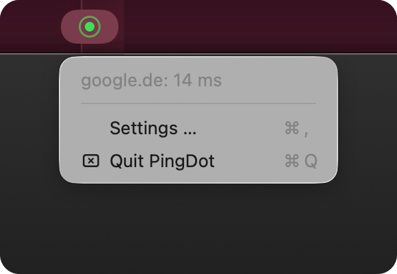
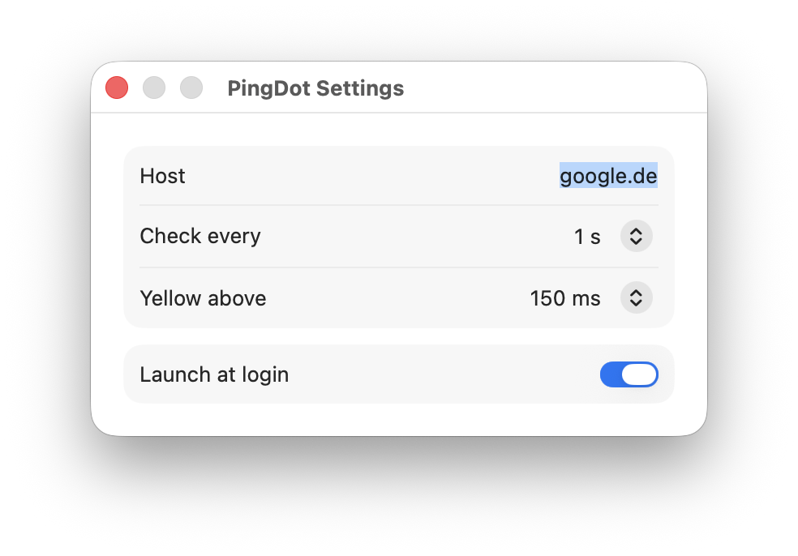
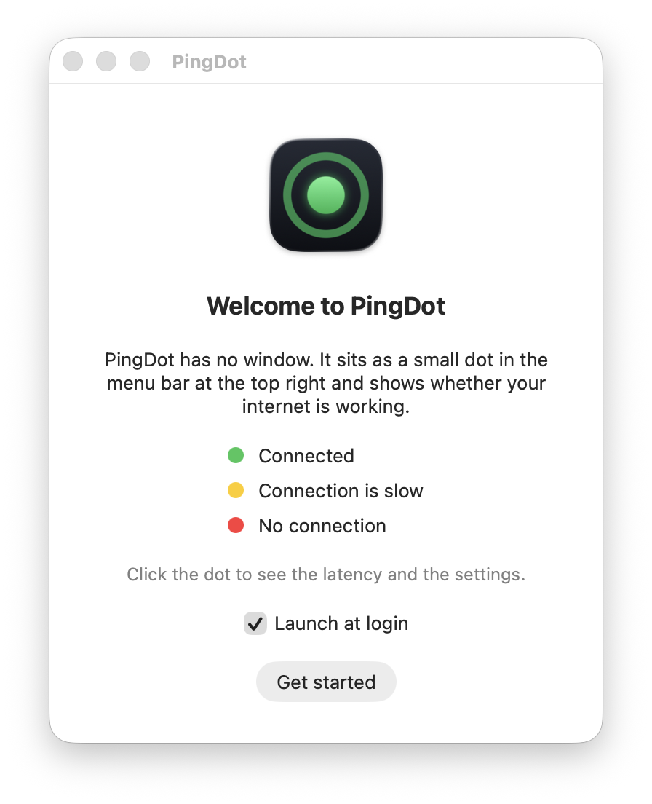

<h1> PingDot</h1>

A tiny macOS menu bar app that shows one dot: is your internet working?

- 🟢 **Green** – connected
- 🟡 **Yellow** – connected, but latency is high
- 🔴 **Red** – no connection

PingDot pings a host (default `google.de`) every second. Click the dot to see the current latency and open the settings.

## Screenshots

| Menu bar | Settings | First launch |
| :---: | :---: | :---: |
|  |  |  |

## Settings

- **Host** – what to ping
- **Check every** – 1, 2, 5, 10 or 30 seconds (default: 1)
- **Yellow above** – latency threshold, 50 to 500 ms
- **Launch at login**

The dot turns red after two failed pings in a row, so a single lost packet does not make it flicker.

## Install

1. Download `PingDot-<version>.zip` from the [latest release](https://github.com/xyNNN/pingdot/releases/latest) and unzip it.
2. Move `PingDot.app` to your Applications folder and open it.

PingDot is signed with an Apple Developer ID and notarized by Apple (since version 1.1.0).

Requires macOS 13 or later, Apple Silicon or Intel.

## Build from source

Needs the Xcode command line tools (`xcode-select --install`), nothing else.

```sh
./build.sh            # builds build/PingDot.app
./build.sh install    # also copies it to /Applications and starts it
```

`./make-icon.sh` regenerates the app icon, `./release.sh` builds a signed and notarized zip (see the header of that file).

## Limitations

Some networks block ICMP ping (hotel Wi-Fi, some VPNs). There the dot stays red although the internet works.

## License

[MIT](LICENSE)
